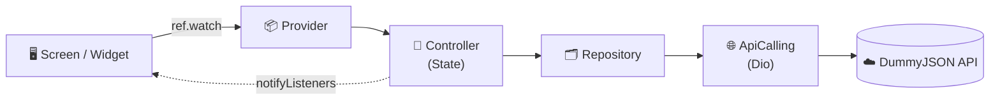
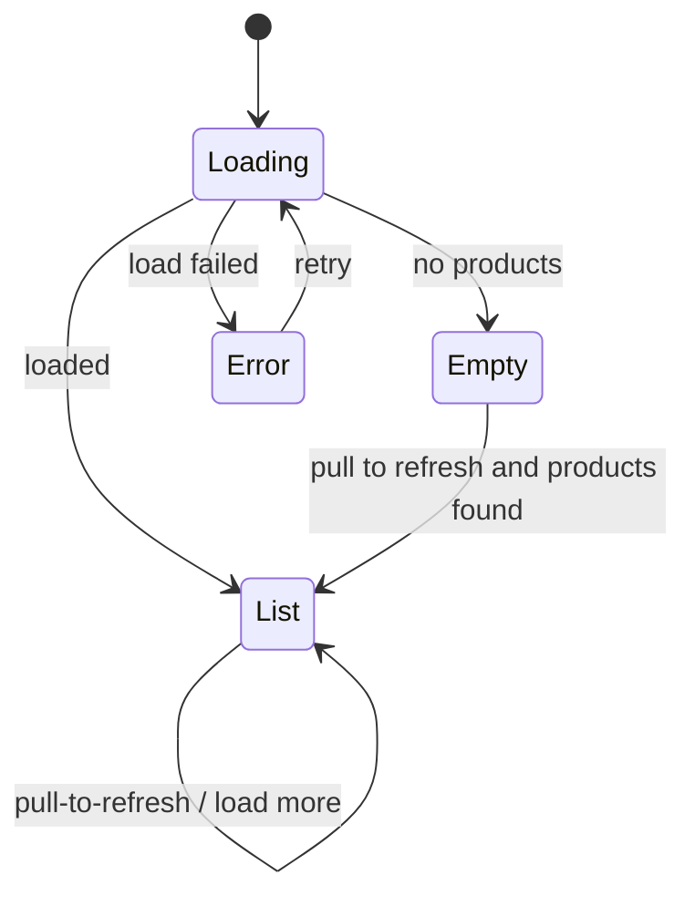

<div align="center">

🌐 [ภาษาไทย](README.md) · **English**

# 🛍️ CatalogX

### Product Catalog Application

A Flutter app that shows a product list and product details, fetching data from a REST API.<br/>
Supports **Mobile** and **Tablet**. The UI follows the Figma design.

<br/>

[](https://flutter.dev)
[](https://dart.dev)
[](https://riverpod.dev)
[](https://pub.dev/packages/dio)
[](https://www.figma.com/design/mVmxLnfHb04VCphyuq2sKI/CatalogX---Product-Catalog--Flutter-UI-?node-id=0-1)

[🎨 View the design on Figma](https://www.figma.com/design/mVmxLnfHb04VCphyuq2sKI/CatalogX---Product-Catalog--Flutter-UI-?node-id=0-1) · [🔌 DummyJSON API](https://dummyjson.com/products)

</div>

---

## 📑 Table of Contents

- [📸 Screenshots](#-screenshots)
- [✅ Requirements Coverage](#-requirements-coverage)
- [🎨 Design](#-design)
- [🏗️ Architecture](#️-architecture)
- [📁 Project Structure](#-project-structure)
- [🚀 Getting Started](#-getting-started)
- [🔌 API](#-api)
- [💡 Key Design Decisions](#-key-design-decisions)
- [🧪 Testing Guide](#-testing-guide)
- [⚠️ Known Limitations](#️-known-limitations)

---

## 📸 Screenshots

> The app UI is in Thai, following the Figma design.

### 📱 Mobile

| Product list | Product detail | Loading | Error | Empty |
|:---:|:---:|:---:|:---:|:---:|
|  |  |  |  |  |

### 💻 Tablet

| Product list | Product detail |
|:---:|:---:|
|  |  |

<details>
<summary><b>🔽 List footer states (Pagination)</b></summary>

<br/>

| More pages | Loading more | Load failed | All loaded |
|:---:|:---:|:---:|:---:|
|  |  |  |  |

</details>

---

## ✅ Requirements Coverage

| # | Requirement | How it's done |
|:---:|---|---|
| 1 | Show a product list with image, name and price | `ProductCard` laid out in a grid |
| 2 | Tap a product to open the Product Detail page | `Navigator.push` passes the `productId`; the Detail page loads the full data from the API |
| 3 | Use Riverpod for state management | `ChangeNotifierProvider.autoDispose` + `HookConsumerWidget` |
| 4 | Use Dio to call the API | All in one place: `ApiCalling` |
| 5 | Show Loading, Error and Empty states | Pulsing skeleton / Error page with a retry button ("ลองใหม่") / Empty page |
| 6 | Support Pull-to-Refresh | `CupertinoSliverRefreshControl` pushes the list down while refreshing, as in the design (if a refresh fails, the existing list stays) |
| 7 | Pagination or Load More | A "Load more" button ("โหลดเพิ่มเติม") using `limit` + `skip`, 20 items per page |
| 8 | Support Mobile and Tablet screens | The grid adapts its column count to the width; the Detail page splits into 2 columns when the width is ≥ 600 |
| 9 | Separate UI / State / Repository | See [Architecture](#️-architecture) |
| 10 | Do not hardcode product data | All product data comes from the API |

### ✨ Extras beyond the requirements

- 🖼️ **Image gallery on the Detail page** Swipe or tap a thumbnail to change the image; thumbnails are hidden when a product has only one image
- 💀 **Skeleton loading** Same column count and height as the real page, so nothing jumps when the data arrives
- 🔁 **All 4 list footer states** More pages / loading / load failed (retry available) / all loaded
- 🇹🇭 **Thai error messages** Converted from `DioException` in one place

---

## 🎨 Design

The whole UI follows this Figma file:
**[CatalogX – Product Catalog (Flutter UI)](https://www.figma.com/design/mVmxLnfHb04VCphyuq2sKI/CatalogX---Product-Catalog--Flutter-UI-?node-id=0-1)**

| Figma frame | Implemented as |
|---|---|
| Components (AppBar, ProductCard, Skeleton) | `CatalogAppBar`, `DetailAppBar`, `ProductCard`, `ProductCardSkeleton` |
| Mobile / Product List | Product list page |
| Mobile / Pull-to-Refresh | `CupertinoSliverRefreshControl` + a custom-drawn spinner circle |
| Mobile / Loading | `ProductGridSkeleton` |
| Mobile / Error | `ErrorStateView` |
| Mobile / Empty | `EmptyStateView` |
| Mobile / Product Detail | `ProductDetailScreen` |
| Pagination Footer States | `ProductListFooter` |
| Tablet / Product List, Product Detail | Layout used when the width is ≥ 600 |

### 🎛️ Design Tokens

Defined in one place, [`lib/configs/app_theme.dart`](lib/configs/app_theme.dart). Every widget reads them through `context.themeColor` / `context.textTheme`.

| Token | Color | Value | Used for |
|---|:---:|---|---|
| `bg` |  | `#F5F6FA` | Page background |
| `surface` |  | `#FFFFFF` | Cards, AppBar |
| `border` |  | `#E8EAF0` | Card border |
| `primary` |  | `#2F5BEA` | Price, logo, buttons |
| `primarySoft` |  | `#E7EEFD` | Product image background |
| `skeleton` |  | `#EDEFF5` | Skeleton boxes |
| `text` |  | `#111827` | Primary text |
| `textMuted` |  | `#6B7280` | Secondary text |
| `error`\* |  | `#DC2626` | Error page |
| `errorSoft`\* |  | `#FEE2E2` | Error icon circle |

> Font: **IBM Plex Sans Thai** (via `google_fonts`)

### 📐 Responsive

| | 📱 Mobile (< 600) | 💻 Tablet (≥ 600) |
|---|:---:|:---:|
| Screen edge padding | 16 | 24 (Detail: 32) |
| Grid columns | 2 | 3 (portrait) |
| Card height | 267 | 340 |
| Detail page | Stacked vertically | 2 columns (gallery 380 \| info) |

---

## 🏗️ Architecture

Split into layers; each layer only knows the one directly below it.



| Layer | Responsibility |
|---|---|
| **screen / widget** | Display only. Reads from the controller and calls its methods; knows nothing about Dio |
| **controller** | Holds the state (items, loading, error, whether more pages exist) and calls the repository |
| **repository** | Knows which endpoint to call, then converts the JSON into models |
| **configs/network** | Configures Dio and converts `DioException` into `NetworkException` in one place |

### 🔄 Product list states



---

## 📁 Project Structure

```
lib/
 ├─ main.dart, app.dart
 ├─ configs/
 │   ├─ app_config.dart          # locator (get_it)
 │   ├─ app_theme.dart           # colors and typography
 │   └─ network/                 # api_calling, endpoint, network_exception
 ├─ controllers/
 │   └─ safe_change_notifier.dart
 ├─ utils/
 │   └─ context_extension.dart   # context.themeColor / context.textTheme
 ├─ widgets/                     # shared widgets (skeleton_box, state_message_view)
 └─ features/product/
     ├─ controller/              # product_list_controller, product_detail_controller
     ├─ models/                  # product_model, product_list_model
     ├─ providers/               # product_provider
     ├─ repository/              # product_repository
     ├─ screen/                  # product_list_screen, product_detail_screen
     └─ widget/                  # cards, grid, gallery, list footer, etc.
```

---

## 🚀 Getting Started

**Requirements:** Flutter SDK and an emulator or a physical device (an internet connection is needed to fetch data and images)

```bash
# 1. Clone the project
git clone <repository-url>
cd product_catalog_application

# 2. Install packages
flutter pub get

# 3. Run the app
flutter run
```

Check code quality:

```bash
flutter analyze
```

### 📦 Main packages

| Package | Purpose |
|---|---|
| `hooks_riverpod` + `flutter_hooks` | State management and hooks |
| `dio` | REST API calls |
| `get_it` | Looks up `ApiCalling` from one place |
| `cached_network_image` | Image loading with caching |
| `google_fonts` | IBM Plex Sans Thai font |
| `gap` | Spacing |

---

## 🔌 API

Base URL: `https://dummyjson.com`

| Method | Endpoint | Purpose |
|:---:|---|---|
| `GET` | `/products?limit=20&skip=0` | Product list (pagination) |
| `GET` | `/products/{id}` | Product detail |

Pagination: loads 20 items at a time. The next request uses `skip = number of items already loaded` and stops once `total` is reached.

---

## 💡 Key Design Decisions

<details>
<summary><b>Separate errors for the first page and for Load More</b></summary>

<br/>

If loading the next page fails, the items that were already loaded must not disappear. So there are two fields: `errorMessage` (switches to the full-screen Error page) and `loadMoreErrorMessage` (shown at the end of the list with a retry button).

</details>

<details>
<summary><b>Preventing Refresh and Load More from colliding</b></summary>

<br/>

If the user pulls to refresh while the next page is loading, the two results would overlap and the list would end up inconsistent. The `isRefreshing` / `isLoadingMore` flags make sure that while one is running, the other does not start.

</details>

<details>
<summary><b>Using <code>SliverGridDelegateWithMaxCrossAxisExtent</code> with one shared delegate</b></summary>

<br/>

The column count adapts to the screen width automatically. The real grid and the skeleton grid share the same delegate, so their layouts match and nothing jumps when the data arrives.

</details>

<details>
<summary><b>Converting errors in one place</b></summary>

<br/>

`ApiCalling` catches `DioException` and converts it into a `NetworkException` with a Thai message, so the repository and controller layers never need to know about Dio.

</details>

<details>
<summary><b>Layered product image</b></summary>

<br/>

A soft color background sits at the bottom and the real image is drawn on top once it has loaded. While loading, or if the image fails, the colored background with an icon is still visible, so there is never an empty gap.

</details>

<details>
<summary><b>Pull-to-Refresh that pushes the list down</b></summary>

<br/>

The design moves the list down to make room for the spinner, but Material's `RefreshIndicator` draws the spinner on top of the list. So `CupertinoSliverRefreshControl` is used instead, with the spinner circle drawn to match the design (`BouncingScrollPhysics` is needed so the list can overscroll at the top). The Empty page still uses `RefreshIndicator`, since there is no list to push down.

</details>

<details>
<summary><b>SafeChangeNotifier</b></summary>

<br/>

Prevents `notifyListeners()` from being called after the controller has been disposed (for example, when the user leaves the page before the API responds).

</details>

---

## 🧪 Testing Guide

The project does not have automated tests yet. This section is a manual testing guide for checking each state.

### 📴 Turning Airplane mode on/off in the emulator

Swipe down twice from the top status bar to open Quick Settings, then tap **Airplane mode** (turn it off when you finish testing). Turning Wi-Fi off also works.

### ✅ Can be tested right away, no code changes needed

| State | Steps | Expected result |
|---|---|---|
| Normal list | Open the app with internet access | Product cards in 2 columns (Mobile) or 3 columns (Tablet, portrait) |
| First-page error | Turn Airplane mode on, then open the app | Error page with a Thai message. Turn Airplane mode off and tap "ลองใหม่" (Retry); it should load |
| Load more | Scroll to the bottom and tap "โหลดเพิ่มเติม" (Load more) | A spinner replaces the button, then the list grows to 40 items and the text reads "แสดง 40 จาก 194 รายการ" (Showing 40 of 194 items) |
| Load more fails | Scroll to the bottom, turn Airplane mode on, then tap "โหลดเพิ่มเติม" | Red message + "ลองใหม่" (Retry), and the existing items stay. Turn Airplane mode off and tap "ลองใหม่" |
| Pull-to-Refresh | Load 40 items, scroll to the top, then pull down | The list is pushed down, the circle spins, then it returns to "แสดง 20 จาก 194 รายการ" (Showing 20 of 194 items) |
| Refresh fails | Turn Airplane mode on, then pull down to refresh | The existing items stay; no Error page appears |
| Detail | Tap a product card | Image, chips, name, rating, price, stock, description (several images: "1/N" badge and thumbnails; a single image: none) |
| Detail fails | Turn Airplane mode on, then tap a card | Error page inside the Detail page; "ลองใหม่" (Retry) works |
| Tablet | Run on a Pixel Tablet, or rotate the emulator to landscape | The list adapts its columns to the width; Detail splits into 2 columns |

---

## ⚠️ Known Limitations

- No data caching for offline use
- Load more uses a button; it does not load automatically when scrolling to the end of the list
- Uses `ChangeNotifierProvider` (the older Riverpod API) instead of `Notifier` / `AsyncNotifier`

---

<div align="center">

Built with 💙 Flutter

**Developer:** Nonthawat Deekham · [GitHub](https://github.com/NonthawatD) · [LinkedIn](https://www.linkedin.com/in/nonthawatdeekham) · [Email](mailto:boss.nontarwat@gmail.com)

</div>
