<div align="center">

🌐 **ภาษาไทย** · [English](README.en.md)

# 🛍️ CatalogX

### Product Catalog Application

แอป Flutter แสดงรายการสินค้าและรายละเอียดสินค้า ดึงข้อมูลจาก REST API<br/>
รองรับ **Mobile** และ **Tablet** ออกแบบ UI ตาม Figma

<br/>

[](https://flutter.dev)
[](https://dart.dev)
[](https://riverpod.dev)
[](https://pub.dev/packages/dio)
[](https://www.figma.com/design/mVmxLnfHb04VCphyuq2sKI/CatalogX---Product-Catalog--Flutter-UI-?node-id=0-1)

[🎨 ดูดีไซน์ใน Figma](https://www.figma.com/design/mVmxLnfHb04VCphyuq2sKI/CatalogX---Product-Catalog--Flutter-UI-?node-id=0-1) · [🔌 DummyJSON API](https://dummyjson.com/products)

</div>

---

## 📑 สารบัญ

- [📸 ตัวอย่างหน้าจอ](#-ตัวอย่างหน้าจอ)
- [✅ ฟีเจอร์ตามโจทย์](#-ฟีเจอร์ตามโจทย์)
- [🎨 ดีไซน์](#-ดีไซน์)
- [🏗️ สถาปัตยกรรม](#️-สถาปัตยกรรม)
- [📁 โครงสร้างโปรเจกต์](#-โครงสร้างโปรเจกต์)
- [🚀 วิธีรัน](#-วิธีรัน)
- [🔌 API ที่ใช้](#-api-ที่ใช้)
- [💡 การตัดสินใจออกแบบที่สำคัญ](#-การตัดสินใจออกแบบที่สำคัญ)
- [🧪 วิธีทดสอบ](#-วิธีทดสอบ)
- [⚠️ ข้อจำกัดที่ทราบ](#️-ข้อจำกัดที่ทราบ)

---

## 📸 ตัวอย่างหน้าจอ

### 📱 Mobile

| รายการสินค้า | รายละเอียดสินค้า | Loading | Error | Empty |
|:---:|:---:|:---:|:---:|:---:|
| 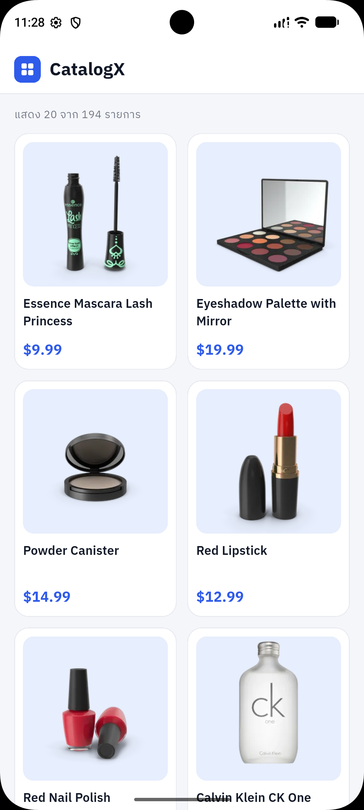 | 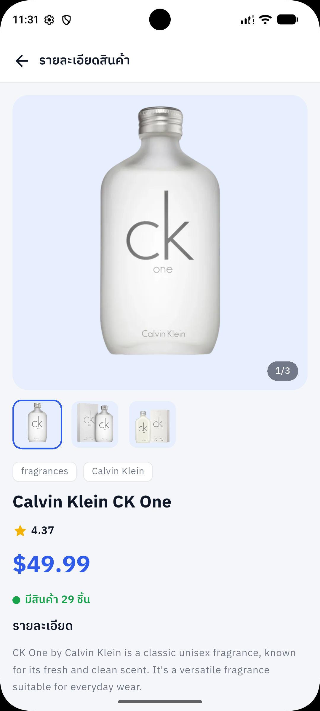 | 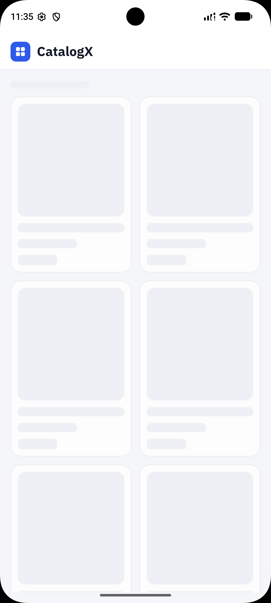 | 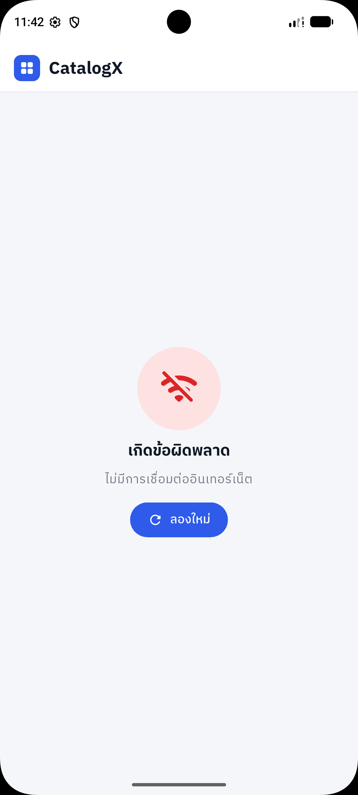 | 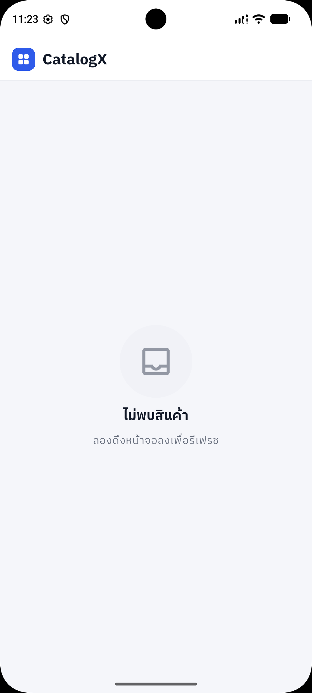 |

### 💻 Tablet

| รายการสินค้า | รายละเอียดสินค้า |
|:---:|:---:|
| 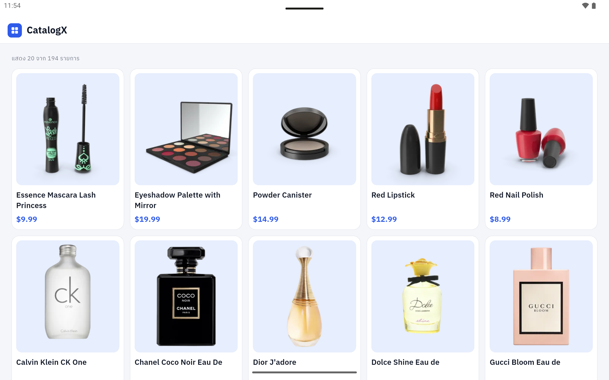 | 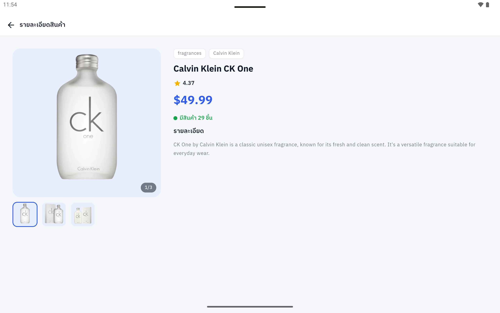 |

<details>
<summary><b>🔽 สถานะส่วนท้ายลิสต์ (Pagination)</b></summary>

<br/>

| มีหน้าถัดไป | กำลังโหลด | โหลดไม่สำเร็จ | โหลดครบแล้ว |
|:---:|:---:|:---:|:---:|
| 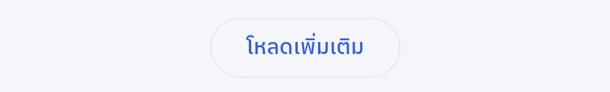 | 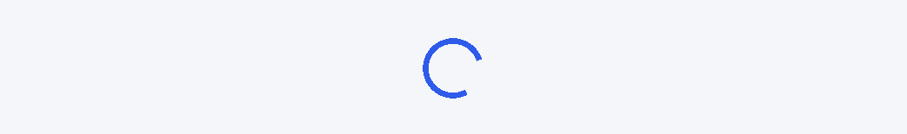 | 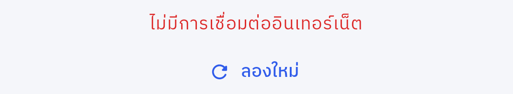 | 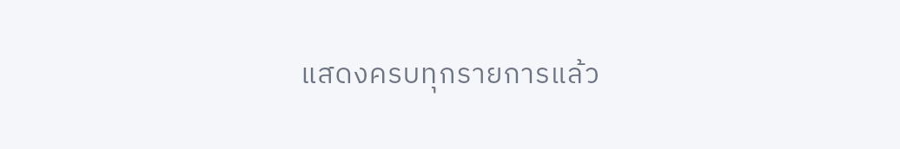 |

</details>

---

## ✅ ฟีเจอร์ตามโจทย์

| # | ข้อกำหนด | ทำไว้อย่างไร |
|:---:|---|---|
| 1 | แสดงรายการสินค้าพร้อมรูป ชื่อ และราคา | `ProductCard` เรียงใน Grid |
| 2 | กดสินค้าเพื่อเปิดหน้า Product Detail | `Navigator.push` ส่ง `productId` ไปให้หน้า Detail โหลดข้อมูลเต็มจาก API |
| 3 | ใช้ Riverpod จัดการ State | `ChangeNotifierProvider.autoDispose` + `HookConsumerWidget` |
| 4 | ใช้ Dio เชื่อมต่อ API | รวมอยู่ที่ `ApiCalling` ที่เดียว |
| 5 | แสดง Loading, Error และ Empty State | Skeleton กะพริบ / หน้า Error พร้อมปุ่ม "ลองใหม่" / หน้า Empty |
| 6 | รองรับ Pull-to-Refresh | `CupertinoSliverRefreshControl` ดันรายการลงตอนรีเฟรชตามดีไซน์ (ถ้ารีเฟรชพลาด รายการเดิมไม่หาย) |
| 7 | Pagination หรือ Load More | ปุ่ม "โหลดเพิ่มเติม" ใช้ `limit` + `skip` ครั้งละ 20 รายการ |
| 8 | รองรับหน้าจอ Mobile และ Tablet | Grid ปรับจำนวนคอลัมน์ตามความกว้าง หน้า Detail แบ่ง 2 คอลัมน์เมื่อกว้าง ≥ 600 |
| 9 | แยก UI / State / Repository | ดู [สถาปัตยกรรม](#️-สถาปัตยกรรม) |
| 10 | ห้าม hardcode รายการสินค้า | ข้อมูลสินค้าทั้งหมดมาจาก API |

### ✨ ส่วนที่เพิ่มจากโจทย์

- 🖼️ **แกลเลอรีรูปในหน้า Detail** ปัดหรือกดรูปย่อเพื่อเปลี่ยนรูป และซ่อนรูปย่อเมื่อสินค้ามีรูปเดียว
- 💀 **Skeleton Loading** จำนวนคอลัมน์และความสูงเท่าหน้าจริง ข้อมูลมาแล้วไม่กระตุก
- 🔁 **สถานะท้ายลิสต์ครบ 4 แบบ** มีหน้าถัดไป / กำลังโหลด / โหลดไม่สำเร็จ (ลองใหม่ได้) / แสดงครบแล้ว
- 🇹🇭 **ข้อความ error ภาษาไทย** แปลงจาก `DioException` ที่จุดเดียว

---

## 🎨 ดีไซน์

UI ทั้งหมดทำตามไฟล์ Figma:
**[CatalogX – Product Catalog (Flutter UI)](https://www.figma.com/design/mVmxLnfHb04VCphyuq2sKI/CatalogX---Product-Catalog--Flutter-UI-?node-id=0-1)**

| เฟรมใน Figma | หน้าที่ทำในแอป |
|---|---|
| Components (AppBar, ProductCard, Skeleton) | `CatalogAppBar`, `DetailAppBar`, `ProductCard`, `ProductCardSkeleton` |
| Mobile / Product List | หน้ารายการสินค้า |
| Mobile / Pull-to-Refresh | `CupertinoSliverRefreshControl` + วงกลมหมุนที่วาดเอง |
| Mobile / Loading | `ProductGridSkeleton` |
| Mobile / Error | `ErrorStateView` |
| Mobile / Empty | `EmptyStateView` |
| Mobile / Product Detail | `ProductDetailScreen` |
| Pagination Footer States | `ProductListFooter` |
| Tablet / Product List, Product Detail | เลย์เอาต์เมื่อความกว้าง ≥ 600 |

### 🎛️ Design Tokens

กำหนดไว้ที่เดียวใน [`lib/configs/app_theme.dart`](lib/configs/app_theme.dart) ทุก widget เรียกผ่าน `context.themeColor` / `context.textTheme`

| โทเคน | สี | ค่า | ใช้กับ |
|---|:---:|---|---|
| `bg` |  | `#F5F6FA` | พื้นหลังหน้า |
| `surface` |  | `#FFFFFF` | การ์ด, AppBar |
| `border` |  | `#E8EAF0` | ขอบการ์ด |
| `primary` |  | `#2F5BEA` | ราคา, โลโก้, ปุ่ม |
| `primarySoft` |  | `#E7EEFD` | พื้นหลังรูปสินค้า |
| `skeleton` |  | `#EDEFF5` | กล่อง Skeleton |
| `text` |  | `#111827` | ข้อความหลัก |
| `textMuted` |  | `#6B7280` | ข้อความรอง |
| `error`\* |  | `#DC2626` | หน้า Error |
| `errorSoft`\* |  | `#FEE2E2` | วงกลมไอคอน Error |

> ฟอนต์: **IBM Plex Sans Thai** (ผ่าน `google_fonts`)

### 📐 Responsive

| | 📱 Mobile (< 600) | 💻 Tablet (≥ 600) |
|---|:---:|:---:|
| padding ขอบหน้าจอ | 16 | 24 (Detail: 32) |
| คอลัมน์ใน Grid | 2 | 3 (แนวตั้ง) |
| ความสูงการ์ด | 267 | 340 |
| หน้า Detail | เรียงลงมา | 2 คอลัมน์ (แกลเลอรี 380 \| ข้อมูล) |

---

## 🏗️ สถาปัตยกรรม

แยกเป็นชั้น ๆ แต่ละชั้นรู้จักแค่ชั้นที่อยู่ถัดลงไป

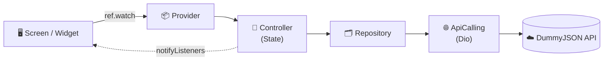

| ชั้น | หน้าที่ |
|---|---|
| **screen / widget** | แสดงผลอย่างเดียว อ่านค่าจาก controller และเรียกเมธอด ไม่รู้จัก Dio |
| **controller** | เก็บ state (รายการ, loading, error, มีหน้าถัดไปไหม) และสั่งงาน repository |
| **repository** | รู้ว่าต้องเรียก endpoint ไหน แล้วแปลง JSON เป็น Model |
| **configs/network** | ตั้งค่า Dio และแปลง `DioException` เป็น `NetworkException` ที่จุดเดียว |

### 🔄 สถานะของหน้ารายการ

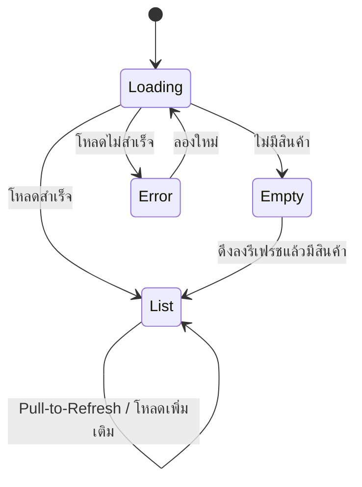

---

## 📁 โครงสร้างโปรเจกต์

```
lib/
 ├─ main.dart, app.dart
 ├─ configs/
 │   ├─ app_config.dart          # locator (get_it)
 │   ├─ app_theme.dart           # สีและตัวอักษร
 │   └─ network/                 # api_calling, endpoint, network_exception
 ├─ controllers/
 │   └─ safe_change_notifier.dart
 ├─ utils/
 │   └─ context_extension.dart   # context.themeColor / context.textTheme
 ├─ widgets/                     # widget ใช้ร่วมกัน (skeleton_box, state_message_view)
 └─ features/product/
     ├─ controller/              # product_list_controller, product_detail_controller
     ├─ models/                  # product_model, product_list_model
     ├─ providers/               # product_provider
     ├─ repository/              # product_repository
     ├─ screen/                  # product_list_screen, product_detail_screen
     └─ widget/                  # การ์ด กริด แกลเลอรี ส่วนท้ายลิสต์ ฯลฯ
```

---

## 🚀 วิธีรัน

**สิ่งที่ต้องมี:** Flutter SDK และ emulator หรืออุปกรณ์จริง (ต้องต่ออินเทอร์เน็ตเพื่อดึงข้อมูลและรูปภาพ)

```bash
# 1. โคลนโปรเจกต์
git clone <repository-url>
cd product_catalog_application

# 2. ติดตั้งแพ็กเกจ
flutter pub get

# 3. รันแอป
flutter run
```

ตรวจคุณภาพโค้ด:

```bash
flutter analyze
```

### 📦 แพ็กเกจหลัก

| แพ็กเกจ | ใช้ทำอะไร |
|---|---|
| `hooks_riverpod` + `flutter_hooks` | จัดการ State และ hooks |
| `dio` | เรียก REST API |
| `get_it` | หา `ApiCalling` จากที่เดียว |
| `cached_network_image` | โหลดรูปพร้อมแคช |
| `google_fonts` | ฟอนต์ IBM Plex Sans Thai |
| `gap` | เว้นระยะ |

---

## 🔌 API ที่ใช้

Base URL: `https://dummyjson.com`

| Method | Endpoint | ใช้ทำอะไร |
|:---:|---|---|
| `GET` | `/products?limit=20&skip=0` | รายการสินค้า (Pagination) |
| `GET` | `/products/{id}` | รายละเอียดสินค้า |

Pagination: โหลดครั้งละ 20 รายการ ครั้งถัดไปใช้ `skip = จำนวนสินค้าที่โหลดมาแล้ว` และหยุดเมื่อโหลดครบ `total`

---

## 💡 การตัดสินใจออกแบบที่สำคัญ

<details>
<summary><b>แยก error ของหน้าแรกกับของ Load More</b></summary>

<br/>

ถ้าโหลดหน้าถัดไปพลาด รายการที่โหลดไว้แล้วต้องไม่หายไป จึงแยกเป็น `errorMessage` (สลับไปหน้า Error เต็มจอ) กับ `loadMoreErrorMessage` (แสดงที่ท้ายลิสต์พร้อมปุ่มลองใหม่)

</details>

<details>
<summary><b>กันการชนกันของ Refresh กับ Load More</b></summary>

<br/>

ถ้าผู้ใช้ดึงรีเฟรชระหว่างที่กำลังโหลดหน้าถัดไป ผลจะซ้อนกันและรายการผิดเพี้ยน จึงมีธง `isRefreshing` / `isLoadingMore` ให้ฝั่งใดฝั่งหนึ่งทำงานอยู่ อีกฝั่งจะไม่เริ่มซ้อน

</details>

<details>
<summary><b>ใช้ <code>SliverGridDelegateWithMaxCrossAxisExtent</code> และ delegate ตัวเดียวร่วมกัน</b></summary>

<br/>

ให้จำนวนคอลัมน์ปรับตามความกว้างจออัตโนมัติ และใช้ delegate ตัวเดียวกันทั้งหน้าจริงกับหน้า Skeleton เพื่อให้เลย์เอาต์ตรงกัน ไม่กระตุกตอนข้อมูลมาถึง

</details>

<details>
<summary><b>แปลง error ที่จุดเดียว</b></summary>

<br/>

`ApiCalling` จับ `DioException` แล้วแปลงเป็น `NetworkException` พร้อมข้อความภาษาไทย ชั้น repository และ controller จึงไม่ต้องรู้จัก Dio เลย

</details>

<details>
<summary><b>รูปสินค้าเป็นชั้น ๆ</b></summary>

<br/>

พื้นสีอ่อนอยู่ล่างสุด รูปจริงทับด้านบนเมื่อโหลดเสร็จ ระหว่างโหลดหรือรูปเสีย จะยังเห็นพื้นสีพร้อมไอคอน ไม่เป็นช่องว่าง

</details>

<details>
<summary><b>Pull-to-Refresh แบบดันรายการลง</b></summary>

<br/>

ดีไซน์ให้รายการเลื่อนลงเปิดที่ให้วงหมุน แต่ `RefreshIndicator` ของ Material วางวงหมุนทับรายการ จึงใช้ `CupertinoSliverRefreshControl` แทน แล้ววาดวงกลมหมุนตามดีไซน์เอง (ต้องใช้ `BouncingScrollPhysics` เพื่อให้เลื่อนเกินขอบบนได้) ส่วนหน้า Empty ยังใช้ `RefreshIndicator` เพราะไม่มีรายการให้ดัน

</details>

<details>
<summary><b>SafeChangeNotifier</b></summary>

<br/>

กันการเรียก `notifyListeners()` หลัง controller ถูก dispose (เช่นผู้ใช้ออกจากหน้าก่อนที่ API จะตอบกลับ)

</details>

---

## 🧪 วิธีทดสอบ

โปรเจกต์ยังไม่มี automated test ส่วนนี้เป็นคู่มือทดสอบด้วยมือสำหรับตรวจแต่ละสถานะ

### 📴 เปิด/ปิด Airplane mode ใน emulator

ลากแถบสถานะด้านบนลง 2 ครั้งเพื่อเปิด Quick Settings แล้วแตะ **Airplane mode** (ปิดเมื่อทดสอบเสร็จ) หรือปิด Wi-Fi แทนก็ได้

### ✅ ทดสอบได้เลย ไม่ต้องแก้โค้ด

| สถานะ | ขั้นตอน | ผลที่ควรเห็น |
|---|---|---|
| รายการปกติ | เปิดแอปตอนมีอินเทอร์เน็ต | การ์ดสินค้า 2 คอลัมน์ (Mobile) หรือ 3 คอลัมน์ (Tablet แนวตั้ง) |
| Error หน้าแรก | เปิด Airplane mode แล้วเปิดแอป | หน้า Error พร้อมข้อความไทย ปิด Airplane mode แล้วกด "ลองใหม่" ต้องโหลดได้ |
| Load More | เลื่อนลงสุด กด "โหลดเพิ่มเติม" | วงหมุนแทนปุ่ม แล้วสินค้าเพิ่มเป็น 40 ข้อความเป็น "แสดง 40 จาก 194 รายการ" |
| Load More ไม่สำเร็จ | เลื่อนลงสุด เปิด Airplane mode แล้วกด "โหลดเพิ่มเติม" | ข้อความแดง + "ลองใหม่" และสินค้าเดิมยังอยู่ ปิด Airplane mode แล้วกด "ลองใหม่" |
| Pull-to-Refresh | โหลดเพิ่มให้ได้ 40 ชิ้น เลื่อนขึ้นบนสุด แล้วดึงลง | รายการถูกดันลง วงกลมหมุน แล้วกลับเป็น "แสดง 20 จาก 194 รายการ" |
| Refresh ไม่สำเร็จ | เปิด Airplane mode แล้วดึงลงรีเฟรช | สินค้าเดิมยังอยู่ ไม่ขึ้นหน้า Error |
| Detail | กดการ์ดสินค้า | รูป ชิป ชื่อ คะแนน ราคา สต็อก คำอธิบาย (หลายรูป: มี "1/N" และรูปย่อ, รูปเดียว: ไม่มี) |
| Detail ไม่สำเร็จ | เปิด Airplane mode แล้วกดการ์ด | หน้า Error ในหน้า Detail กด "ลองใหม่" ได้ |
| Tablet | รันบน Pixel Tablet หรือหมุนจอ emulator เป็นแนวนอน | List ปรับคอลัมน์ตามความกว้าง Detail แบ่ง 2 คอลัมน์ |

---

## ⚠️ ข้อจำกัดที่ทราบ

- ไม่มีการแคชข้อมูลสำหรับใช้งานออฟไลน์
- Load More ใช้ปุ่ม ไม่ได้โหลดอัตโนมัติเมื่อเลื่อนถึงท้ายลิสต์
- ใช้ `ChangeNotifierProvider` (API แบบเดิมของ Riverpod) แทน `Notifier` / `AsyncNotifier`

---

<div align="center">

พัฒนาด้วย 💙 Flutter

**ผู้พัฒนา:** Nonthawat Deekham · [GitHub](https://github.com/NonthawatD) · [LinkedIn](https://www.linkedin.com/in/nonthawatdeekham) · [Email](mailto:boss.nontarwat@gmail.com)

</div>